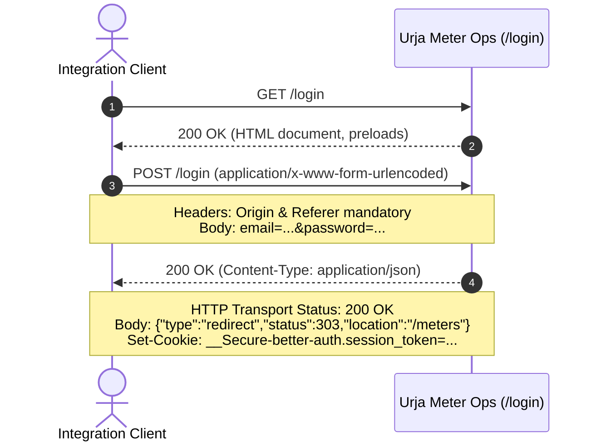

# Urja Meter Ops — Protocol & Legacy System Investigation Report

## 1. Purpose & Scope

This document details the reverse-engineered network protocol, authentication mechanisms, data structures, and operational quirks of **Urja Meter Ops** (`https://urja-ops.flockenergy.tech`). 

The legacy portal is an internal web application used by utility field and operations staff to inspect smart electricity meters, network placement, and consumption telemetry. Because the application exposes no documented public API, this investigation establishes the empirical baseline for building a clean, robust, read-only integration service.

---

## 2. Investigation Methodology

The investigation was conducted methodically using a combination of automated browser telemetry (Playwright) and targeted direct HTTP probes:

1. **Passive Reconnaissance**: Inspected DNS resolution for the portal hostname (`urja-ops.flockenergy.tech`), HTTP redirects (`302 Found` to `/login`), and initial response headers (`X-Sveltekit-Page: true`, `Etag`).
2. **Autonomous Headed & Headless Browser Exploration**: Controlled Chromium via Playwright to log in using provided operator credentials, systematically navigating through the Dashboard, Meter Search, Meter Details, Consumption, and Distribution Transformers views.
3. **Network Event Interception**: Attached listeners to `page.on('request')` and `page.on('response')`, capturing HTTP methods, URL paths, query parameters, header requirements, response status codes, content types, and response schemas while strictly redacting credentials and consumer PII.
4. **Client-Side Bundle Analysis**: Inspected client-side JavaScript chunks (specifically `4.2Bgc2kUI.js`) to reverse-engineer hidden export signing algorithms and event listeners.
5. **Direct HTTP Verification**: Verified that all internal endpoints could be queried programmatically via Node.js native `fetch` with an in-memory cookie jar, eliminating any dependency on headless browsers for the production integration service.

---

## 3. Legacy Application Architecture

* **Framework**: SvelteKit with client-side hydration (`__sveltekit_uzbk0k`).
* **Underlying Auth Library**: `better-auth` (*Inferred* from cookie naming `__Secure-better-auth.session_token` and client redirect payload structures).
* **API Style**: Hybrid SvelteKit data loaders (`/__data.json`) and internal REST-like JSON endpoints under `/portal/*`.
* **Session Transport**: HTTP transport governed by a session token cookie (`__Secure-better-auth.session_token`). Server-side session storage mechanisms (e.g. in-memory session table or database store) and token encryption or hashing internals were not independently established from client-side observation.

---

## 4. Authentication Protocol

### 4.1 Handshake Sequence

Authentication requires a two-step HTTP exchange:



1. **Initial GET `/login`**: Establishes initial connection and validates endpoint reachability.
2. **Credential Submission (POST `/login`)**:
   * **Method**: `POST`
   * **Content-Type**: `application/x-www-form-urlencoded`
   * **Payload**: Form fields `email` and `password`.
   * **Required Headers**:
     * `Origin`: `https://urja-ops.flockenergy.tech`
     * `Referer`: `https://urja-ops.flockenergy.tech/login`
     * *Note: Requests omitting these headers are rejected by SvelteKit's CSRF cross-site form protection.*
   * **HTTP Transport Status**: `200 OK` (Content-Type: `application/json`).
   * **Application Payload Status**: The JSON response body carries an internal status field `status: 303` with `type: "redirect"`:
     ```json
     {
       "type": "redirect",
       "status": 303,
       "location": "/meters"
     }
     ```
   * *Critical Protocol Distinction*: The HTTP transport status code (`200 OK`) and the JSON body's internal redirection status (`303`) are distinct layers. The server does not issue an HTTP-level `303 See Other` response status code for `POST /login`; rather, it returns a `200 OK` JSON response instructing the SvelteKit client-side form action runner to navigate to `/meters`.

### 4.2 Session Token & Cookie Specifications

Upon successful credential validation, the server issues a session cookie in the `Set-Cookie` response header:
* **Cookie Name**: `__Secure-better-auth.session_token`
* **Attributes**: `HttpOnly; Secure; SameSite=Lax; Path=/; Max-Age=3600`
* **Cookie Max-Age vs. Server-Side Lifetime**: The response header specifies `Max-Age=3600` (1-hour client-side cookie persistence). Note that this client-side attribute is distinct from confirmed server-side session expiration: whether the upstream server strictly invalidates sessions after 3600 seconds, extends session validity on ongoing activity, or allows server-side revocation was not independently verified.
* **Transport**: All subsequent requests to `/portal/*` endpoints must attach this cookie in the `Cookie` request header.

### 4.3 Session Expiration Behavior

When a session expires or an unauthenticated request reaches an internal endpoint:
* The portal returns either `401 Unauthorized` or an `HTTP 30x` redirect with `Location: /login`.
* The integration client detects this condition, invalidates the cached session, executes a single-flight login handshake, and retries the original request once.

---

## 5. Meter Search & Listing Protocol

### Endpoint
`GET /portal/meters/search?q={query}&page={page}`

* **Authentication**: Requires valid session cookie.
* **Query Parameters**:
  * `q` (string, optional): Substring search query matching meter identifier or manufacturer serial number. Empty string (`q=`) retrieves all meters.
  * `page` (integer, optional): 1-based page index (defaults to `1`).
* **Observed Pagination & Dataset Snapshot**: Fixed `pageSize` of 20 meters per page. During investigation, a total dataset snapshot of 403 meters across 21 pages was observed. This represents an empirical snapshot rather than a guaranteed static inventory count.
* **Observed Response Schema**:
  ```json
  {
    "data": [
      {
        "meterId": "MTR-EXAMPLE-001",
        "serialNo": "SN-EXAMPLE-001",
        "make": "HPL",
        "phaseType": "single",
        "installStatus": "Decommissioned",
        "dtCode": "DT-EXAMPLE-01"
      }
    ],
    "total": 403,
    "page": 1,
    "pageSize": 20
  }
  ```

---

## 6. Meter Geolocation Protocol

### Endpoint
`GET /portal/meters/:meterId/geo`

* **Authentication**: Requires valid session cookie.
* **Path Parameter**: `:meterId` (URL-encoded meter identifier, e.g. `MTR-EXAMPLE-001`).
* **Response Status**: `200 OK` (or `404 Not Found` if coordinates are unassigned).
* **Observed Response Schema**:
  ```json
  {
    "data": {
      "latitude": "0.000000",
      "longitude": "0.000000"
    }
  }
  ```
* **Coordinate Representation**: Coordinates are transmitted by the upstream portal as decimal-formatted strings rather than floating-point numbers. *(Note: Coordinates shown in examples throughout this documentation are synthetic illustrative placeholders and do not represent actual meter installation locations.)*

---

## 7. Consumption Telemetry Protocol

### Endpoint
`GET /portal/meters/:meterId/energy`

* **Authentication**: Requires valid session cookie.
* **Path Parameter**: `:meterId` (URL-encoded meter identifier).
* **Observed Response Schema**:
  ```json
  {
    "data": [
      {
        "timestamp": "23/06/2026 23:30",
        "kwh": "1000.50",
        "kvah": "1050.75",
        "voltR": "230"
      }
    ]
  }
  ```
  *(Note: Telemetry values shown in examples are synthetic illustrative data preserving upstream field names, types, and formatting.)*

### 7.1 Field Semantics & Measurement Properties

* **`timestamp`**: Formatted as `DD/MM/YYYY HH:mm`. Telemetry records reflect ~30-minute intervals covering approximately 7 continuous days (an observed sample count of approximately 337 readings was noted during the investigation, though this represents an empirical snapshot rather than a guaranteed count for every meter).
  * *Timezone Consideration*: Timestamps arrive without UTC offset or timezone indicator. Downstream services must not introduce arbitrary UTC or offset assumptions, preserving unconfirmed local semantics (`LOCAL_TIMEZONE_UNCONFIRMED`).
* **`kwh`**: **Cumulative active energy register** (kilowatt-hours).
  * *Critical Distinction*: These values represent cumulative energy registers, **not** discrete 30-minute interval delta consumption values.
  * *Monotonicity*: Although readings advanced over the sampled period, readings cannot be assumed to always increase monotonically under all operational conditions (e.g. meter replacement, register rollover, or field calibration).
* **`kvah`**: **Cumulative apparent energy register** (kilovolt-ampere-hours). Reflects total power vector including reactive power.
* **`voltR`**: Instantaneous R-phase voltage in Volts (typically ~220–240 V). Whether this measurement reflects true RMS or sampled instantaneous voltage was not independently confirmed from the telemetry payload.
* **Quirk**: All numeric values arrive as decimal strings and must be parsed into IEEE 754 floats and integers.

---

## 8. Distribution Network Hierarchy

### 8.1 Discovered Organizational Structure

The utility distribution topology follows a strict 7-level physical and organizational hierarchy from administrative region down to customer meter:

```
[Zone]                   e.g. Zone A (Z-01)
  │
  └── [Circle]           e.g. Circle 1 (C-01)
        │
        └── [Division]   e.g. Division 1 (D-01)
              │
              └── [Subdivision]   e.g. Subdivision 1 (SD-01)
                    │
                    └── [Substation]   e.g. Substation 1 (SS-01)
                          │
                          └── [Feeder]   e.g. Feeder 1 (F-001)
                                │
                                └── [Distribution Transformer]   e.g. Distribution Transformer 1 (DT-001)
                                      │
                                      └── [Smart Meter]   e.g. MTR-EXAMPLE-001
```

### 8.2 Transformer Endpoint Limitations (`/portal/dts`)

The portal exposes a transformer list at `GET /portal/dts?page=1`:
```json
{
  "data": [
    {
      "code": "DT-001",
      "name": "Distribution Transformer 1",
      "feederCode": "F-001",
      "capacityKva": 100
    }
  ],
  "total": 20,
  "page": 1,
  "pageSize": 20
}
```
* **Discovery**: `/portal/dts` only maps transformers (`code`) to feeders (`feederCode`). It completely omits the upper 5 hierarchy tiers (Substation, Subdivision, Division, Circle, Zone).
* **Engineering Decision**: `/portal/dts` is insufficient to satisfy the network hierarchy requirement. The signed export was therefore investigated and selected.

---

## 9. Reverse-Engineered HMAC-SHA256 Signed Bulk Export

On the `/transformers` screen, an "Export all meters" action initiates a request to an export API protected by dynamic HMAC-SHA256 signature verification.

### 9.1 Dynamic Signing Key Retrieval
`GET /portal/keys`
* **Response**:
  ```json
  {
    "data": {
      "signingSecret": "<REDACTED_SIGNING_SECRET>"
    }
  }
  ```
* *Security Note*: The signing secret is retrieved dynamically over an authenticated session and must never be committed to source code or logged in plain text.

### 9.2 Canonical Message Construction & Signature Algorithm

Extracted from client bundle `4.2Bgc2kUI.js` and verified against implementation:

```javascript
// Canonical string format:
const canonicalString = [METHOD, PATH, QUERY, TIMESTAMP].join('\n');
// Example for GET /portal/export?page=1:
// "GET\n/portal/export\npage=1\n1793798718"

// HMAC-SHA256 signature generation:
const signature = crypto
  .createHmac('sha256', signingSecret)
  .update(canonicalString)
  .digest('hex');
```

* **Timestamp Parameter**: Formatted as a Unix epoch timestamp in seconds, represented as a decimal string (e.g. `String(Math.floor(Date.now() / 1000))`).
* **Signature Header**: Formatted as a 64-character lowercase hex digest generated by HMAC-SHA256 using the retrieved signing secret.

### 9.3 Signed Request Execution
`GET /portal/export?page=1`
* **Required Headers**:
  * `x-timestamp`: Epoch timestamp in seconds (`String(Math.floor(Date.now() / 1000))`).
  * `x-signature`: 64-character lowercase hex digest of the HMAC-SHA256.
  * `Cookie`: Valid session cookie.
* **Response & Dataset Snapshot**: Returns a JSON payload (~231 KB) containing an observed snapshot of **403 meters** with their full 7-level electrical hierarchy and meter attributes. This count represents an empirical snapshot captured during investigation rather than a fixed upper limit.
  ```json
  {
    "data": [
      {
        "meterId": "MTR-EXAMPLE-001",
        "serialNo": "SN-EXAMPLE-001",
        "make": "HPL",
        "phaseType": "single",
        "installStatus": "Decommissioned",
        "installType": "Whole Current",
        "build": "legacy",
        "dtCode": "DT-001",
        "hierarchy": {
          "zone": { "name": "Zone A", "code": "Z-01" },
          "circle": { "name": "Circle 1", "code": "C-01" },
          "division": { "name": "Division 1", "code": "D-01" },
          "subdivision": { "name": "Subdivision 1", "code": "SD-01" },
          "substation": { "name": "Substation 1", "code": "SS-01" },
          "feeder": { "name": "Feeder 1", "code": "F-001" },
          "dt": { "name": "Distribution Transformer 1", "code": "DT-001" }
        },
        "geo": {
          "lat": 0.000000,
          "lng": 0.000000
        }
      }
    ],
    "total": 403
  }
  ```
  *(Note: Coordinates and identifiers shown in examples are synthetic illustrative placeholders and do not represent actual meter installation locations.)*

### 9.4 Separation of Secret Retrieval and Hierarchy Index Caching

* **Dynamic Secret Handling**: The signing key is fetched on-demand from `GET /portal/keys` and used by the client signer to generate HMAC signatures for export requests.
* **Hierarchy-Index Caching**: Because the upstream portal only exposes the complete 7-level hierarchy via the bulk export endpoint, the integration service maintains an in-memory cache of the indexed hierarchy graph (with a 5-minute TTL and single-flight concurrency lock) to resolve individual meter lookups efficiently without repeatedly triggering bulk export requests. These two concerns (ephemeral request signing vs. domain data caching) operate independently.

---

## 10. Summary of Legacy System Quirks & Surprises

| Behavior / Quirk | Legacy Portal Manifestation | Integration Impact / Solution |
|---|---|---|
| **CSRF Origin Enforcement** | Unauthenticated `POST /login` fails with `403 Forbidden` if headers are omitted. | Client explicitly provides `Origin` and `Referer` headers matching the portal base URL. |
| **Transport vs Body Status** | `POST /login` returns HTTP `200 OK` with JSON body `{ "type": "redirect", "status": 303 }`. | Auth manager evaluates HTTP status 200 and parses body redirection attributes without treating it as an HTTP-level error. |
| **Silent Session Expiration** | Expired cookies trigger `30x` redirects to `/login` rather than standard `401`. | HTTP client treats any `30x` redirect containing `/login` as session expiration and triggers automatic re-authentication. |
| **Cookie Max-Age vs Server Session** | Cookie header states `Max-Age=3600`. | Client respects cookie header, but does not assume the server cannot invalidate or extend sessions independently. |
| **Unzoned Timestamps** | Telemetry timestamps are formatted as `DD/MM/YYYY HH:mm` with no UTC offset. | Strict calendar parser converts to unzoned local ISO (`YYYY-MM-DDTHH:mm:00`) and metadata flags `timestampSemantics: "LOCAL_TIMEZONE_UNCONFIRMED"`. |
| **Cumulative Energy Registers** | `kwh` and `kvah` represent cumulative energy registers, not interval deltas. | Fields are named `cumulativeActiveEnergyKwh` to prevent erroneous interpretation as interval consumption. Monotonicity is not assumed as a permanent invariant. |
| **Incomplete Transformer API** | `/portal/dts` only contains Feeder and Transformer codes. | Implemented HMAC-SHA256 signature generator to query `/portal/export`, resolving the complete 7-level hierarchy. |
| **Dynamic Signing Key Retrieval** | Signing secret is served dynamically via `/portal/keys`. | Client fetches active secret on-demand. Distinct from the separate in-memory caching of the parsed hierarchy dataset. |
| **Dataset Snapshot Size** | Observed total of 403 meters. | Treated as an empirical snapshot of the dataset during investigation rather than a fixed capacity guarantee. |

---

## 11. Upstream-to-Domain Mapping Matrix

| Legacy Portal Field | Legacy Type | Domain Model Field | Normalized Domain Type | Transformation / Rule |
|---|---|---|---|---|
| `meterId` | `string` | `id` | `string` | Trimmed, casing preserved |
| `serialNo` | `string` | `serialNumber` | `string` | Trimmed |
| `make` | `string` | `make` | `string` | Trimmed |
| `phaseType` | `string` | `phaseType` | `string` | Lowercased (`single`, `three`) |
| `installStatus` | `string` | `installationStatus` | `string` | Trimmed |
| `dtCode` | `string` | `transformerCode` | `string` | Trimmed |
| `latitude` | `string` | `location.latitude` | `number` | Float parsed; bounded to `[-90, 90]` |
| `longitude` | `string` | `location.longitude` | `number` | Float parsed; bounded to `[-180, 180]` |
| `timestamp` | `string` (`DD/MM/YYYY HH:mm`) | `sourceTimestamp` | `string` | Exact source format preserved |
| `timestamp` | `string` (`DD/MM/YYYY HH:mm`) | `timestampLocal` | `string` | Parsed to local ISO `YYYY-MM-DDTHH:mm:00` |
| `kwh` | `string` | `cumulativeActiveEnergyKwh` | `number` | Float parsed; NaN rejected |
| `kvah` | `string` | `cumulativeApparentEnergyKvah`| `number` | Float parsed; NaN rejected |
| `voltR` | `string` | `voltageR` | `number` | Integer parsed; Volts preserved (RMS unconfirmed) |
| `hierarchy.dt` | `{ name, code }` | `transformer` | `{ name, code } \| null` | Renamed for domain clarity |

---

## 12. Evidence Classification Summary

* **CONFIRMED**:
  * SvelteKit architecture and CSRF requirements on `POST /login` (requires matching `Origin` and `Referer`).
  * Distinct HTTP transport status code `200 OK` versus application JSON body redirect indicator `{ "type": "redirect", "status": 303, "location": "/meters" }`.
  * `__Secure-better-auth.session_token` cookie issuance and client-side `Max-Age=3600` header attribute.
  * Query parameters and response shapes for `/portal/meters/search`, `/portal/meters/:id/geo`, and `/portal/meters/:id/energy`.
  * Telemetry readings at ~30-minute intervals per meter across ~7 days (observed sample count of ~337 readings per meter during investigation).
  * Cumulative energy register semantics for `kwh` and `kvah`.
  * 7-level hierarchy structure (`Zone` → `Circle` → `Division` → `Subdivision` → `Substation` → `Feeder` → `DT` → `Meter`).
  * Canonical HMAC-SHA256 signature algorithm (`METHOD\nPATH\nQUERY\nTIMESTAMP`) with `x-timestamp` and `x-signature` headers required for `/portal/export`.
  * Dynamic signing secret endpoint `GET /portal/keys`.
  * Empirical dataset snapshot of 403 meters at the time of investigation.
* **INFERRED**:
  * `better-auth` is utilized as the underlying authentication library based on cookie naming convention and form handler response structure.
  * Distribution hierarchy naming and structure reflect regional electrical utility distribution network territory conventions.
* **UNKNOWN**:
  * Formal timestamp timezone offset (whether Indian Standard Time `UTC+05:30` or configured per utility).
  * Server-side session storage mechanism, token encryption/hashing internals, or server-side expiration lifecycle beyond the client-side `Max-Age=3600` cookie attribute.
  * Signing key rotation schedule (whether static, periodic, or session-scoped).
  * Voltage measurement method for `voltR` (true RMS vs instantaneous sampled).
  * Long-term data retention window for energy telemetry beyond the observed 7-day period.
