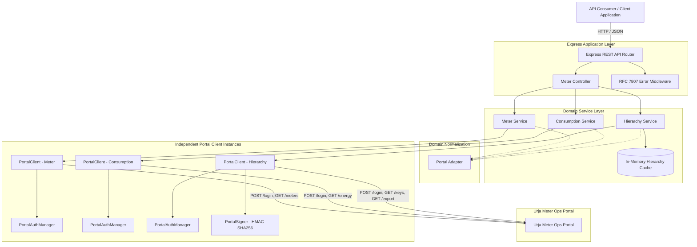
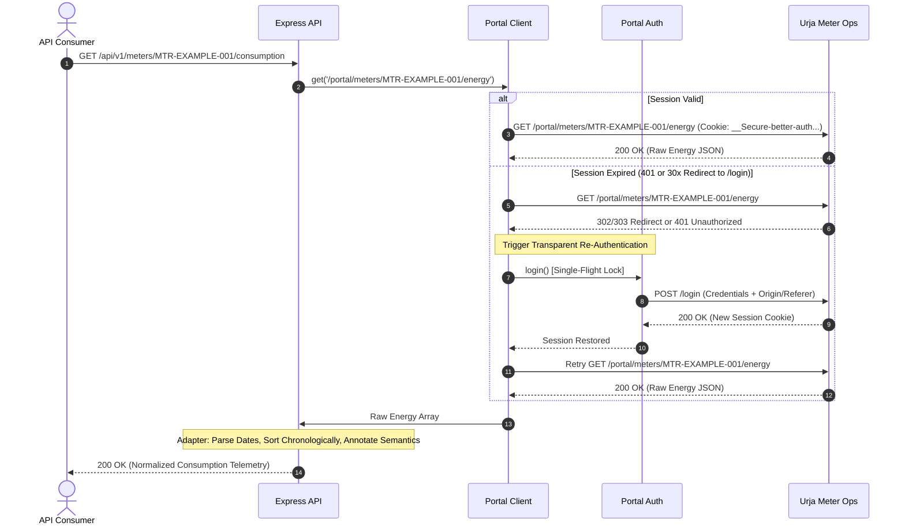

# Urja Meter Ops — Integration Service & Clean REST API

[](https://nodejs.org/)
[](https://www.typescriptlang.org/)
[](https://expressjs.com/)
[]()
[](./openapi.json)

A read-only API integration service built in TypeScript and Express.js over the internal utility management portal **Urja Meter Ops** (`https://urja-ops.flockenergy.tech`).

This service reverse-engineers the legacy portal's authentication, session management, distribution hierarchy, and consumption telemetry, exposing clean, strictly validated REST endpoints with standardized **RFC 7807 Problem Details** error handling.

---

## Table of Contents

1. [Problem & Overview](#1-problem--overview)
2. [Implemented Features](#2-implemented-features)
3. [Architecture & Data Flow](#3-architecture--data-flow)
4. [Project Directory Structure](#4-project-directory-structure)
5. [Technology Stack & Dependencies](#5-technology-stack--dependencies)
6. [Prerequisites](#6-prerequisites)
7. [Installation & Setup](#7-installation--setup)
8. [Environment Configuration](#8-environment-configuration)
9. [Running the Service](#9-running-the-service)
10. [API Reference](#10-api-reference)
11. [Executable `curl` Usage Examples](#11-executable-curl-usage-examples)
12. [Error Handling Architecture](#12-error-handling-architecture)
13. [Engineering Decisions & Trade-offs](#13-engineering-decisions--trade-offs)
14. [Assumptions & Limitations](#14-assumptions--limitations)
15. [Intentionally Omitted Features](#15-intentionally-omitted-features)
16. [Future Improvements & Production Roadmap](#16-future-improvements--production-roadmap)
17. [Verification & Testing Report](#17-verification--testing-report)
18. [Companion Documents](#18-companion-documents)
19. [Reflection](#19-reflection)

---

## 1. Problem & Overview

Power utilities and field engineering teams rely on internal systems like **Urja Meter Ops** to monitor smart electricity meters, inspect distribution infrastructure, and inspect recent consumption telemetry containing cumulative active and apparent energy registers, along with reported R-phase voltage. However, integrating with the legacy portal presents several engineering challenges:

- **No Public API**: The portal only exposes internal JSON and HTML endpoints designed for its proprietary SvelteKit frontend.
- **CSRF & Session Validation**: Authentication is session-bound via cookies (`__Secure-better-auth.session_token`). Login requests require specific `Origin` and `Referer` headers to pass upstream origin checks.
- **Hidden Network Hierarchy**: The application UI displays only shallow transformer-to-feeder links (`/portal/dts`), while the complete 7-level physical distribution hierarchy (Zone &rarr; Circle &rarr; Division &rarr; Subdivision &rarr; Substation &rarr; Feeder &rarr; Distribution Transformer &rarr; Meter) is locked behind a bulk export endpoint requiring dynamic **HMAC-SHA256 signature generation**.
- **Ambiguous Telemetry Formats**: Consumption records are provided in unzoned local timestamp formats (`DD/MM/YYYY HH:mm`), with cumulative energy registers (`kwh`, `kvah`) rather than interval deltas, alongside decimal-formatted coordinate strings.

This service acts as an **Anti-Corruption Layer (ACL)** between client applications and the Urja portal. It executes direct HTTP calls with session persistence, validates and normalizes domain models, generates cryptographic signatures for bulk export data, and serves structured, type-safe REST endpoints.

---

## 2. Implemented Features

- **Direct HTTP Integration**: 100% native HTTP execution via Node.js native `fetch`. Eliminates the process overhead, high memory footprint, and rendering engine complexity of headless browser automation (Playwright/Puppeteer) in production.
- **Session Management**:
  - In-memory cookie persistence and session tracking via `tough-cookie`.
  - Single-flight authentication mutex (`inFlightLogin`) preventing concurrent login stampedes.
  - Transparent re-authentication on 401 Unauthorized or 30x session redirect, with automatic single retry for safe GET queries.
- **Meter Directory & Search**:
  - Paginated search (`GET /api/v1/meters?q={query}&page={page}`).
  - Passes queries directly to upstream search, supporting substring matching on meter identifier (`meterId`) or serial number (`serialNo`).
  - Standardized pagination metadata (`page`, `pageSize`, `total`, `totalPages`, `hasNext`, `hasPrev`).
- **Individual Meter Attributes & Geolocation**:
  - `GET /api/v1/meters/:meterId` combining meter identity (`id`, `serialNumber`, `make`, `phaseType`, `installationStatus`, `transformerCode`) with validated decimal coordinates (`latitude`, `longitude`), with graceful fallback to `null` if GIS data is unavailable.
- **Consumption Telemetry**:
  - `GET /api/v1/meters/:meterId/consumption` returning chronological readings (~7 days of half-hourly readings; observed sample count of ~337 readings per meter during investigation).
  - Explicit sorting in chronological order (`timestampLocal` ascending).
  - Preserves cumulative register semantics (`cumulativeActiveEnergyKwh`, `cumulativeApparentEnergyKvah`, `voltageR`).
  - Explicitly annotates timestamp semantics as `LOCAL_TIMEZONE_UNCONFIRMED` to prevent silent timezone offset errors.
- **7-Level Distribution Network Hierarchy**:
  - `GET /api/v1/meters/:meterId/hierarchy` mapping each meter to its full utility distribution hierarchy:
    $$\text{Zone} \to \text{Circle} \to \text{Division} \to \text{Subdivision} \to \text{Substation} \to \text{Feeder} \to \text{Distribution Transformer} \to \text{Meter}$$
  - Automated HMAC-SHA256 request signing using dynamic secrets fetched from `GET /portal/keys`.
  - In-memory caching with a 5-minute TTL and single-flight loading mutex to prevent cache stampedes.
- **RFC 7807 Problem Details Error Format**: Standardized `application/problem+json` error responses across all routes and unhandled exceptions.
- **Comprehensive Automated Tests**: 41 unit and integration tests covering authentication, client retry, data normalization, HMAC signing, date parsing, and REST controllers.

---

## 3. Architecture & Data Flow

### 3.1 Layered Architecture



Each domain service currently owns its portal-client instance and authentication lifecycle. This keeps domain services independently constructible and testable, at the cost of potentially separate login sessions across service instances. A shared application-scoped portal client could be introduced in a larger deployment to centralize session management.

### 3.2 Request Lifecycle & Transparent Re-Authentication



---

## 4. Project Directory Structure

```
.
├── .env.example                       # Template for environment configuration
├── .gitignore                         # Excludes node_modules, dist, and local .env
├── package.json                       # Dependencies, scripts, and project metadata
├── package-lock.json                  # Locked dependency graph
├── tsconfig.json                      # Strict TypeScript compiler options (Node16)
├── PROTOCOL.md                        # Reverse-engineering report of Urja Meter Ops
├── openapi.json                       # OpenAPI 3.1.0 specification
├── README.md                          # Primary project documentation (this file)
│
├── scripts/
│   └── verify-live-integration.ts     # End-to-end integration test against live portal
│
├── src/
│   ├── app.ts                         # Express app assembly & middleware registration
│   ├── server.ts                      # HTTP server startup & graceful shutdown
│   │
│   ├── config/
│   │   └── env.ts                     # Zod-validated environment configuration
│   │
│   ├── integrations/
│   │   └── urja-portal/
│   │       ├── portal.auth.ts         # Session manager, 2-step login, mutex lock
│   │       ├── portal.client.ts       # HTTP client, cookie jar, retry & reauth
│   │       ├── portal.signer.ts       # HMAC-SHA256 canonical export request signer
│   │       ├── portal.types.ts        # Zod schemas for upstream Urja payloads
│   │       └── portal.adapter.ts      # Anti-corruption normalization layer
│   │
│   ├── middleware/
│   │   ├── error.middleware.ts        # RFC 7807 Problem Details error handler
│   │   └── not-found.middleware.ts    # 404 Not Found RFC 7807 handler
│   │
│   ├── modules/
│   │   ├── consumption/
│   │   │   ├── consumption.service.ts # Telemetry sorting, parsing & normalization
│   │   │   └── consumption.types.ts   # Consumption domain interfaces
│   │   ├── hierarchy/
│   │   │   ├── hierarchy.service.ts   # 7-level hierarchy resolution & TTL caching
│   │   │   └── hierarchy.types.ts     # Hierarchy tree domain interfaces
│   │   └── meters/
│   │       ├── meter.controller.ts    # Express controllers for meter endpoints
│   │       ├── meter.routes.ts        # Route declarations & query/param validation
│   │       ├── meter.schema.ts        # Zod validation schemas for request parameters
│   │       ├── meter.service.ts       # Meter listing, search, and details orchestration
│   │       └── meter.types.ts         # Meter domain interfaces
│   │
│   └── shared/
│       ├── errors/
│       │   └── index.ts               # Domain error hierarchy (AppError, NotFoundError, etc.)
│       └── utils/
│           └── date-parser.ts         # Gregorian calendar parser for DD/MM/YYYY HH:mm
│
└── tests/
    └── unit/
        ├── api.test.ts                # Express route and controller integration tests
        ├── consumption.service.test.ts# Chronological sorting & telemetry tests
        ├── date-parser.test.ts        # Leap year & date parsing unit tests
        ├── hierarchy.service.test.ts  # Hierarchy caching, lookup, and fallback tests
        ├── meter.service.test.ts      # Meter orchestration and search tests
        ├── portal.adapter.test.ts     # Data transformation and normalization tests
        ├── portal.auth.test.ts        # Authentication mutex & session management tests
        ├── portal.client.test.ts      # Client retry, redirect & error handling tests
        └── portal.signer.test.ts      # HMAC-SHA256 signature canonicalization tests
```

---

## 5. Technology Stack & Dependencies

The project is built on Node.js using TypeScript and standard production libraries:

| Package | Declared Version | Purpose |
|---|---|---|
| **express** | `^4.21.2` | Minimalist HTTP routing framework for building the REST API. |
| **zod** | `^3.24.2` | Runtime schema validation for environment variables, request parameters, and upstream contracts. |
| **tough-cookie** | `^5.1.2` | In-memory cookie jar for session persistence and tracking across HTTP requests. |
| **dotenv** | `^16.4.7` | Loads environment configuration from `.env` files into `process.env`. |
| **typescript** | `^5.8.2` | Strict static typing, Node16 module resolution. |
| **vitest** | `^3.0.8` | TypeScript-native test runner for unit and integration suites. |
| **supertest** | `^7.0.0` | HTTP assertion library for integration testing Express routes. |
| **tsx** | `^4.19.3` | TypeScript execute engine for development watch mode. |

---

## 6. Prerequisites

- **Node.js**: `v22.0.0` or higher (verified on `v22.19.0`)
- **npm**: `10.x` or `11.x` (verified on `11.6.2`)
- **Operating System**: Windows, Linux, or macOS
- **Network Access**: Outbound HTTPS connectivity to `https://urja-ops.flockenergy.tech` for live operations.

---

## 7. Installation & Setup

1. **Clone the repository**:
   ```bash
   git clone https://github.com/ankitpandey25009-coder/Flock-Energy-Assignment.git
   cd Flock-Energy-Assignment
   ```

2. **Install dependencies**:
   ```bash
   npm ci
   ```

3. **Configure environment variables**:
   Create your local `.env` file from the provided template:
   ```bash
   copy .env.example .env
   ```
   *(On Unix/macOS: `cp .env.example .env`)*

   Supply your own authorized portal credentials in `.env`:
   ```env
   PORTAL_USERNAME=your_authorized_portal_username
   PORTAL_PASSWORD=your_authorized_portal_password
   ```

4. **Start the development server**:
   ```bash
   npm run dev
   ```

5. **Operational verification commands**:
   ```bash
   npm run typecheck    # Validate static TypeScript types without emitting code
   npm run test         # Run complete automated test suite (Vitest)
   npm run build        # Compile production bundle to dist/
   npm start            # Run compiled production server from dist/server.js
   ```

---

## 8. Environment Configuration

All environment variables are parsed and validated at application startup using Zod in [`src/config/env.ts`](./src/config/env.ts). If any required variable is missing or invalid, the process halts immediately with a clear diagnostic message.

The service recognizes exactly the following variables:

| Variable | Type | Default | Required? | Description |
|---|---|---|---|---|
| `PORT` | integer | `3000` | No | Port on which the Express server listens. |
| `NODE_ENV` | string | `'development'` | No | Environment mode (`'development'`, `'production'`, `'test'`). |
| `PORTAL_BASE_URL` | string (URL) | `'https://urja-ops.flockenergy.tech'` | No | Base URL of the upstream Urja Meter Ops portal. |
| `PORTAL_USERNAME` | string | — | **Yes** | Operator username or email for Urja portal authentication. |
| `PORTAL_PASSWORD` | string | — | **Yes** | Operator password for Urja portal authentication. |
| `REQUEST_TIMEOUT_MS` | integer | `10000` | No | Upstream HTTP request timeout in milliseconds. |

> [!NOTE]
> `.env` is excluded from version control by `.gitignore`. Do not commit credentials or secrets to Git.

---

## 9. Running the Service

### Development Mode (with hot reload)
```bash
npm run dev
```

### Type Checking
```bash
npm run typecheck
```

### Running Automated Tests
```bash
npm run test
```

### Building for Production
```bash
npm run build
```
Compiles TypeScript source code from `src/` to JavaScript in `dist/`.

### Starting in Production Mode
```bash
npm start
```
Runs the compiled application from `dist/server.js`.

---

## 10. API Reference

All successful responses return `Content-Type: application/json`.  
All error responses return `Content-Type: application/problem+json` formatted according to RFC 7807.

### 10.1 Health Check
- **Endpoint**: `GET /health`
- **Description**: Lightweight health check returning server operational status.
- **Response**: `200 OK`
  ```json
  {
    "status": "healthy",
    "timestamp": "2026-11-04T16:45:00.000Z"
  }
  ```

---

### 10.2 List / Search Meters
- **Endpoint**: `GET /api/v1/meters`
- **Supported Query Parameters**:
  - `q` (string, optional, default: `""`): Search query passed directly to the upstream search endpoint (`/portal/meters/search`). Matches against meter identifier (`meterId`) or serial number (`serialNo`).
  - `page` (integer, optional, default: `1`): 1-based page index (must be positive integer).
  *(Note: The page size is fixed at 20 meters per page by the upstream portal; limit is not a configurable parameter).*
- **Response**: `200 OK`
  ```json
  {
    "data": [
      {
        "id": "MTR-EXAMPLE-001",
        "serialNumber": "SN-EXAMPLE-001",
        "make": "HPL",
        "phaseType": "single",
        "installationStatus": "Decommissioned",
        "transformerCode": "DT-001"
      }
    ],
    "pagination": {
      "page": 1,
      "pageSize": 20,
      "total": 403,
      "totalPages": 21,
      "hasNext": true,
      "hasPrev": false
    }
  }
  ```

---

### 10.3 Get Meter Details
- **Endpoint**: `GET /api/v1/meters/:meterId`
- **Path Parameters**:
  - `meterId` (string, required): Unique meter identifier.
- **Description**: Returns normalized meter attributes combined with parsed geographic coordinates (`latitude`, `longitude`). If geolocation is unavailable or unassigned, `location` is set to `null`.
- **Response**: `200 OK`
  ```json
  {
    "data": {
      "id": "MTR-EXAMPLE-001",
      "serialNumber": "SN-EXAMPLE-001",
      "make": "HPL",
      "phaseType": "single",
      "installationStatus": "Decommissioned",
      "transformerCode": "DT-001",
      "location": {
        "latitude": 0.000000,
        "longitude": 0.000000
      }
    }
  }
  ```
  *(Note: Coordinates shown in examples are synthetic illustrative placeholders and do not represent actual meter installation locations.)*

---

### 10.4 Get Consumption Telemetry
- **Endpoint**: `GET /api/v1/meters/:meterId/consumption`
- **Path Parameters**:
  - `meterId` (string, required): Unique meter identifier.
- **Description**: Returns chronological telemetry readings (`timestampLocal` ascending) containing cumulative active and apparent energy registers along with reported R-phase voltage. In our investigation, approximately 337 readings (~7 days of half-hourly readings) were observed for sampled meters (this represents an observed investigation snapshot, not a permanent guarantee for every meter). Energy values represent cumulative energy registers recorded by the physical meter, not discrete interval consumption. Actual interval consumption would need to be derived from differences between consecutive cumulative readings, subject to meter resets, replacement, rollover, and other operational conditions.
- **Response**: `200 OK`
  ```json
  {
    "data": {
      "meterId": "MTR-EXAMPLE-001",
      "readings": [
        {
          "sourceTimestamp": "25/10/2024 00:00",
          "timestampLocal": "2024-10-25T00:00:00",
          "cumulativeActiveEnergyKwh": 1000.5,
          "cumulativeApparentEnergyKvah": 1050.75,
          "voltageR": 230
        }
      ]
    },
    "meta": {
      "readingCount": 337,
      "timestampSemantics": "LOCAL_TIMEZONE_UNCONFIRMED",
      "units": {
        "cumulativeActiveEnergy": "kWh",
        "cumulativeApparentEnergy": "kVAh",
        "voltage": "V"
      },
      "latestReadingTimestampLocal": "2024-10-31T23:30:00"
    }
  }
  ```
  *(Note: Telemetry readings and reading counts shown above are synthetic illustrative examples.)*

---

### 10.5 Get Distribution Network Hierarchy
- **Endpoint**: `GET /api/v1/meters/:meterId/hierarchy`
- **Path Parameters**:
  - `meterId` (string, required): Unique meter identifier.
- **Description**: Returns the 7-level physical distribution network hierarchy (Zone &rarr; Circle &rarr; Division &rarr; Subdivision &rarr; Substation &rarr; Feeder &rarr; Distribution Transformer &rarr; Meter) obtained via HMAC-signed bulk export.
- **Response**: `200 OK`
  ```json
  {
    "data": {
      "meterId": "MTR-EXAMPLE-001",
      "zone": {
        "name": "Zone A",
        "code": "Z-01"
      },
      "circle": {
        "name": "Circle 1",
        "code": "C-01"
      },
      "division": {
        "name": "Division 1",
        "code": "D-01"
      },
      "subdivision": {
        "name": "Subdivision 1",
        "code": "SD-01"
      },
      "substation": {
        "name": "Substation 1",
        "code": "SS-01"
      },
      "feeder": {
        "name": "Feeder 1",
        "code": "F-001"
      },
      "transformer": {
        "name": "Distribution Transformer 1",
        "code": "DT-001"
      }
    },
    "meta": {
      "hierarchyDepth": 8,
      "source": "portal-network-export"
    }
  }
  ```

---

## 11. Executable `curl` Usage Examples

The following `curl.exe` commands are ready to run against a locally running service:

```bash
# 1. Health check
curl.exe -i -s http://localhost:3000/health

# 2. List meters (no-filter pagination — simplest executable request)
curl.exe -i -s "http://localhost:3000/api/v1/meters?page=1"

# 3. Filter meters by query keyword (matches meter identifier or manufacturer serial number)
# Note: Upstream search matches meter ID or serial number substrings (not the manufacturer make field).
# Replace 'MTR-01' with an actual meter ID or serial number fragment present in the authorized portal inventory.
curl.exe -i -s "http://localhost:3000/api/v1/meters?q=MTR-01"

# 4. Fetch specific meter details (including coordinates)
# Note: Replace 'MTR-EXAMPLE-001' with an actual meter ID discovered from your inventory.
curl.exe -i -s http://localhost:3000/api/v1/meters/MTR-EXAMPLE-001

# 5. Fetch consumption telemetry
# Note: Replace 'MTR-EXAMPLE-001' with an actual meter ID discovered from your inventory.
curl.exe -i -s http://localhost:3000/api/v1/meters/MTR-EXAMPLE-001/consumption

# 6. Fetch 7-level distribution network hierarchy
# Note: Replace 'MTR-EXAMPLE-001' with an actual meter ID discovered from your inventory.
curl.exe -i -s http://localhost:3000/api/v1/meters/MTR-EXAMPLE-001/hierarchy

# 7. Non-existent meter (triggers RFC 7807 404 response)
curl.exe -i -s http://localhost:3000/api/v1/meters/MTR-NONEXISTENT
```

---

## 12. Error Handling Architecture

The service adheres strictly to the **RFC 7807 Problem Details** specification. All error responses return `Content-Type: application/problem+json` and follow the exact structure emitted by [`src/middleware/error.middleware.ts`](./src/middleware/error.middleware.ts):

```json
{
  "type": "urn:urja:error:not_found",
  "title": "NOT FOUND",
  "status": 404,
  "detail": "Meter with ID \"MTR-NONEXISTENT\" not found",
  "instance": "/api/v1/meters/MTR-NONEXISTENT",
  "code": "NOT_FOUND",
  "error": {
    "code": "NOT_FOUND",
    "message": "Meter with ID \"MTR-NONEXISTENT\" not found",
    "details": null
  }
}
```

### Error Taxonomy

| HTTP Status | RFC 7807 Type | Application Code | Cause |
|---|---|---|---|
| `400 Bad Request` | `urn:urja:error:validation_error` | `VALIDATION_ERROR` | Request query parameters or path parameters failed Zod validation. Details contained in `error.details`. |
| `404 Not Found` | `urn:urja:error:not_found` | `NOT_FOUND` | The requested meter ID, network hierarchy, or endpoint route was not found. |
| `502 Bad Gateway` | `urn:urja:error:upstream_service_error` / `urn:urja:error:upstream_auth_error` | `UPSTREAM_SERVICE_ERROR` / `UPSTREAM_AUTH_ERROR` | The upstream portal returned an authentication failure, invalid signing key, or unexpected response schema. |
| `504 Gateway Timeout` | `urn:urja:error:upstream_timeout` | `UPSTREAM_TIMEOUT` | Upstream portal request timed out (configured via `REQUEST_TIMEOUT_MS`). |
| `500 Internal Error` | `urn:urja:error:internal_server_error` | `INTERNAL_SERVER_ERROR` | Unhandled internal server exception. |

---

## 13. Engineering Decisions & Trade-offs

### 1. Direct HTTP Integration vs. Browser Automation
- **Decision**: Used Playwright exploratory automation to capture network traffic, observe authentication flows, and inspect and analyze client-side JavaScript bundles, but implemented 100% direct HTTP integration (`fetch` + `tough-cookie`) for the production service without browser runtime dependencies.
- **Rationale**: Headless browsers introduce high process-spawning overhead, heavy RAM consumption, and brittle DOM-coupling. Direct HTTP calls communicate directly with the portal's JSON endpoints, ensuring fast response times, predictable resource usage, and clean containerized deployment.

### 2. In-Memory Hierarchy Caching vs. External Store
- **Decision**: Implemented an in-memory `Map` cache with a 5-minute TTL and single-flight loader in [`src/modules/hierarchy/hierarchy.service.ts`](./src/modules/hierarchy/hierarchy.service.ts).
- **Rationale**: The full 7-level hierarchy is obtained by querying `/portal/export?page=1`, which dumps the entire network graph (observed snapshot of 403 meters). Executing a signed bulk export for every individual meter query would overwhelm the legacy portal and introduce unnecessary latency. An in-memory cache with single-flight mutex amortizes this cost effectively without introducing external infrastructure dependencies like Redis for this single-process service.

### 3. Date Parsing & Timezone Handling
- **Decision**: Authored a custom, strictly validated Gregorian calendar parser in [`src/shared/utils/date-parser.ts`](./src/shared/utils/date-parser.ts) that emits unzoned ISO strings (`YYYY-MM-DDTHH:mm:00`), accompanied by `"timestampSemantics": "LOCAL_TIMEZONE_UNCONFIRMED"`.
- **Rationale**: Upstream timestamps (`DD/MM/YYYY HH:mm`) contain no explicit timezone designator. Rather than assuming or fabricating a timezone (such as UTC or an unconfirmed regional offset), the API preserves the source's local-time representation as an unzoned ISO string and explicitly annotates the payload with `"timestampSemantics": "LOCAL_TIMEZONE_UNCONFIRMED"`. This prevents silent data corruption in downstream billing, analytics, or outage correlation engines.

### 4. Adapter Pattern (Anti-Corruption Layer)
- **Decision**: All upstream JSON payloads are validated through Zod schemas in [`portal.types.ts`](./src/integrations/urja-portal/portal.types.ts) and normalized through [`portal.adapter.ts`](./src/integrations/urja-portal/portal.adapter.ts) into domain models before reaching business logic.
- **Rationale**: Isolates the domain model from upstream quirks, missing keys, inconsistent string formats, and unexpected changes in the legacy application.

---

## 14. Assumptions & Limitations

1. **Read-Only Constraint**: The legacy portal is strictly treated as a read-only system of record. No mutating requests are issued.
2. **Cumulative Energy Registers**: Telemetry fields (`kwh`, `kvah`) are treated as cumulative energy registers recorded by the physical meter, rather than delta consumption during that specific 30-minute interval.
3. **Hierarchy Completeness via Bulk Export**: The `/portal/dts` endpoint only exposes transformers and feeders. The full 7-level hierarchy is derived exclusively from the HMAC-signed export dataset.
4. **Single-Process In-Memory Cache**: The hierarchy cache is held in process memory. In a multi-replica deployment without sticky sessions, each replica maintains its own 5-minute cache.
5. **Empirical Dataset Snapshot**: The observed total of 403 meters reflects the snapshot state of the portal during investigation rather than a permanent upper limit.
6. **API Consumer Authentication & Security Boundary**: This assessment implementation does not enforce authentication or authorization for API consumers. It is intended to run locally or within a trusted network for evaluation purposes. Upstream portal credentials (`PORTAL_USERNAME`, `PORTAL_PASSWORD`) are strictly isolated to server-side environment configuration and are never exposed or returned through the API. Before exposing the service in a production or internet-facing environment, consumer authentication, authorization, rate limiting, and appropriate network access controls should be implemented.

---

## 15. Intentionally Omitted Features

- **No Relational / NoSQL Database**: The assignment mandates an integration service over the legacy portal. The legacy portal is the system of record; introducing a secondary database would introduce data synchronization, staleness, and consistency challenges.
- **No External Message Broker (Kafka / RabbitMQ)**: Out of scope for synchronous REST integration.
- **No Frontend Application**: The requirements specifically specify a backend API service.

---

## 16. Future Improvements & Production Roadmap

If advancing this service to a distributed production deployment:
1. **Background Hierarchy Cache Pre-Warming**: Currently, the first request after cache expiry incurs the latency of fetching `/portal/keys` and `/portal/export`. A background worker could refresh the cache asynchronously every 4 minutes, ensuring consistent low latency for all consumer requests.
2. **Derived Interval Consumption**: Add an optional query parameter (`?includeDeltas=true`) to calculate interval consumption by subtracting adjacent cumulative register readings ($\Delta \text{kWh}_t = \text{kWh}_t - \text{kWh}_{t-1}$), while checking for non-monotonic readings (potential meter rollover or replacement).
3. **Distributed Caching (Redis)**: Replace the in-memory cache with Redis to share cached hierarchy data across horizontally scaled API replicas.
4. **Resiliency with Circuit Breaking**: Wrap upstream portal calls with a circuit breaker (e.g., `cockatiel`) to fail fast and protect the legacy portal during upstream degradation.

---

## 17. Verification & Testing Report

### Automated Test Suite
The codebase includes 41 automated unit and integration tests executed using Vitest:

```
 ✓ tests/unit/date-parser.test.ts (9 tests)
 ✓ tests/unit/portal.signer.test.ts (5 tests)
 ✓ tests/unit/portal.adapter.test.ts (4 tests)
 ✓ tests/unit/portal.auth.test.ts (4 tests)
 ✓ tests/unit/portal.client.test.ts (4 tests)
 ✓ tests/unit/meter.service.test.ts (2 tests)
 ✓ tests/unit/consumption.service.test.ts (3 tests)
 ✓ tests/unit/hierarchy.service.test.ts (3 tests)
 ✓ tests/unit/api.test.ts (7 tests)

 Test Files  9 passed (9)
      Tests  41 passed (41)
```

Run tests locally with:
```bash
npm run test
```

### Live Portal Verification Harness
A dedicated integration verification script ([`scripts/verify-live-integration.ts`](./scripts/verify-live-integration.ts)) tests the entire integration flow against the live Urja portal using configured environment credentials:
- Authenticates using configured portal credentials.
- Queries live meter listings and pagination, discovering a meter dynamically.
- Verifies detailed attributes and GIS coordinate availability for the dynamically discovered meter.
- Retrieves live consumption telemetry readings and verifies chronological ordering.
- Fetches dynamic signing keys and verifies live HMAC-signed export hierarchy resolution.
- Emits safe Boolean and count indicators without printing actual source identifiers, coordinates, or telemetry data to stdout.

---

## 18. Companion Documents

- **[PROTOCOL.md](./PROTOCOL.md)**: Comprehensive legacy system reverse-engineering report detailing endpoints, authentication flows, SvelteKit CSRF headers, and the HMAC-SHA256 signature algorithm.
- **[openapi.json](./openapi.json)**: Complete, validated OpenAPI 3.1.0 specification describing all endpoints, schemas, parameters, and RFC 7807 responses.

---

## 19. Reflection

### 1. What assumptions did you make while building this?
Throughout the reverse-engineering and implementation phases, several key assumptions were established:
- **Read-Only Boundary**: We assumed the legacy portal must be treated strictly as a read-only system of record, precluding any write or mutating operations.
- **Cumulative Energy Registers**: We observed that the `kwh` and `kvah` telemetry values from `GET /portal/meters/:id/energy` increased monotonically across the 337 readings (~7 days of half-hourly readings). We assumed these represent cumulative energy registers rather than interval deltas, preserving the raw values while clearly documenting this semantic in the response model.
- **Local Timezone Unconfirmed**: The legacy portal provides timestamps in the format `DD/MM/YYYY HH:mm` without a timezone offset. Because the upstream telemetry does not explicitly supply a timezone designator, we deliberately chose not to assume or fabricate an unconfirmed timezone offset (such as UTC or Indian Standard Time). We explicitly preserved local unzoned ISO strings and annotated the payload with `timestampSemantics: "LOCAL_TIMEZONE_UNCONFIRMED"` to ensure downstream systems handle timezone semantics deliberately.
- **Hierarchy Completeness via Export**: We verified that while `/portal/dts` contains shallow transformer data, the full 7-level physical hierarchy is comprehensively represented in the bulk `/portal/export` endpoint. We assumed the network graph is relatively static over short windows, making an in-memory 5-minute cache appropriate.

### 2. What was the hardest part of the assignment, and how did you unblock yourself?
The most challenging aspect was uncovering the complete 7-level distribution network hierarchy and reverse-engineering the authentication and signing requirements for `/portal/export`. Initially, inspecting `/portal/dts` only yielded Distribution Transformers and Feeders, lacking the higher levels of the grid hierarchy (Zone, Circle, Division, Subdivision, Substation). 

When inspecting the portal's UI, we discovered an "Export all meters" feature. Direct requests to `/portal/export` failed with HTTP 401/403. To unblock ourselves, we analyzed the client-side JavaScript bundles (specifically chunk `4.2Bgc2kUI.js`), where we identified an internal signing routine that queried `GET /portal/keys` for a dynamic secret. We traced the signature calculation to an **HMAC-SHA256** construction over a canonical string:
$$\text{message} = \text{"GET}\backslash\text{n/portal/export}\backslash\text{npage=1}\backslash\text{n" } + \text{timestamp}$$
By implementing this exact canonicalization in [`src/integrations/urja-portal/portal.signer.ts`](./src/integrations/urja-portal/portal.signer.ts) and attaching `x-timestamp` and `x-signature` headers, we successfully accessed the full export dataset containing all 7 hierarchy tiers.

### 3. If you had another full day to work on this, what would you add or improve?
With an additional day, we would focus on three realistic engineering improvements:
1. **Background Hierarchy Cache Pre-Warming**: Currently, the first request after cache expiry incurs the latency of fetching `/portal/keys` and `/portal/export`. We would implement a background worker that refreshes the cache asynchronously every 4 minutes, guaranteeing low-latency cache hits for all incoming consumer requests.
2. **Delta Consumption Calculations**: We would enhance the consumption endpoint with an optional query parameter (`?includeDeltas=true`) that computes consumption deltas ($\Delta \text{kWh}_t = \text{kWh}_t - \text{kWh}_{t-1}$) alongside cumulative values, flagging any non-monotonic readings (potential meter rollover or physical replacement).
3. **Resilient Retry Backoff & Circuit Breaking**: We would wrap upstream HTTP calls with an adaptive circuit breaker (`cockatiel`) and exponential backoff to handle upstream portal instability gracefully without cascading failures.

### 4. What was one mistake or false assumption you made during the project, and how did you identify and fix it?
During the initial Phase 1 direct HTTP implementation, our authentication manager assumed the legacy portal's `POST /login` would respond with an HTTP `302 Found` or a JSON payload containing `{"type": "success"}`. Instead, direct HTTP requests returned `200 OK` with JSON `{"type": "redirect", "status": 303, "location": "/meters"}`, while the session cookie was set in the response headers. 

Initially, our client threw an `UpstreamAuthenticationError` because it strictly looked for `type === "success"`. We identified this by logging the raw response headers and body from the direct HTTP probe. We immediately corrected the logic in [`src/integrations/urja-portal/portal.auth.ts`](./src/integrations/urja-portal/portal.auth.ts) to accept `type === "redirect"`, `status: 303`, or any `2xx` response containing the required session cookie, resolving the authentication failure.

### 5. Be honest: what is one part of your solution that you're not completely satisfied with, and why?
The aspect we are least completely satisfied with is the necessity of querying the bulk `/portal/export` endpoint to resolve the distribution network hierarchy for an individual meter. 

Because the legacy application does not expose an individual `GET /portal/meters/:id/hierarchy` endpoint, resolving the hierarchy for a single meter requires fetching the entire 403-meter network graph. While our in-memory cache with single-flight mutex mitigates this by amortizing the cost across all requests for 5 minutes, an initial "cold start" or cache miss requires transferring and parsing the entire export payload (~230KB) just to satisfy a single meter lookup. In a production system with hundreds of thousands of meters, downloading a massive bulk dump to resolve one meter's lineage would not scale; it would require an out-of-band ingestion pipeline that syncs the hierarchy into a local read-optimized graph store or indexed database. Given the constraints of this assignment (no database, direct integration), our in-memory cached solution is a pragmatic compromise, but conceptually imperfect for point lookups.
